## Instituição

`ETEC Vasco Antônio Venchiarutti`

---

## Curso

`Informática para Internet`

---

## Turma

`2°D`

---

## Autores

* `Arthur Alexandre Dias Silva`
* `Helena Bianquini Carriço`

---

# Projeto – Aplicativo de Perguntas com API

## Objetivo do aplicativo:

O objetivo deste aplicativo é auxiliar os usuários nos estudos por meio de um material de apoio em PDF e de um questionário interativo. O aplicativo utiliza uma API para obter perguntas armazenadas em um banco de dados, permitindo que o usuário pratique o conteúdo de maneira dinâmica e realize o questionário quantas vezes desejar.

## Funcionamento:

Ao iniciar o aplicativo, o usuário pode acessar um material de estudos disponibilizado em PDF. Para abrir o documento, é utilizado o componente **Activity Starter** do MIT App Inventor, que direciona o usuário para a visualização do arquivo.

A parte do questionário utiliza o componente **Web** do App Inventor para realizar a comunicação com uma API. Essa API consulta um banco de dados que contém **30 perguntas** cadastradas e disponibiliza os dados para o aplicativo.

A cada tentativa, são selecionadas **10 perguntas** entre as 30 disponíveis. A ordem das perguntas é aleatória, tornando cada realização do questionário diferente. O usuário pode responder ao questionário quantas vezes desejar.

Após responder às perguntas, o aplicativo apresenta o resultado por meio de indicações visuais com cores: as respostas corretas e incorretas são destacadas de maneiras diferentes, permitindo identificar os acertos e os pontos que precisam ser revisados.

## Tecnologias e componentes utilizados:

* **MIT App Inventor:** plataforma utilizada para desenvolver a interface e a lógica do aplicativo.
* **Activity Starter:** componente utilizado para abrir o material de estudos em PDF.
* **Web:** componente utilizado para realizar requisições à API e obter as perguntas.
* **API e banco de dados:** utilizados para armazenar e disponibilizar as 30 perguntas que compõem o questionário.

---

## Prints das telas do aplicativo

### Design da Tela Inicial
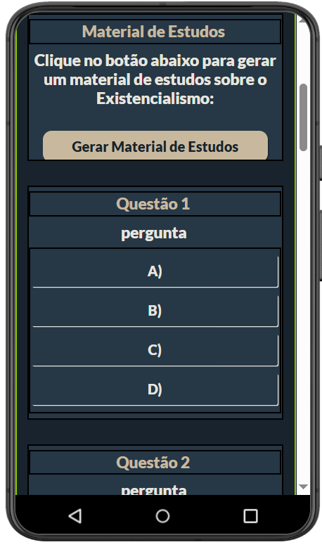

### Blocos da Tela Inicial
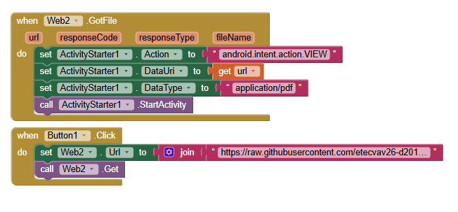

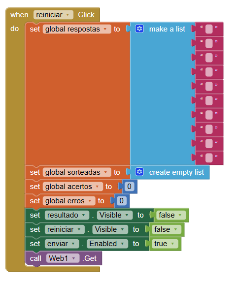

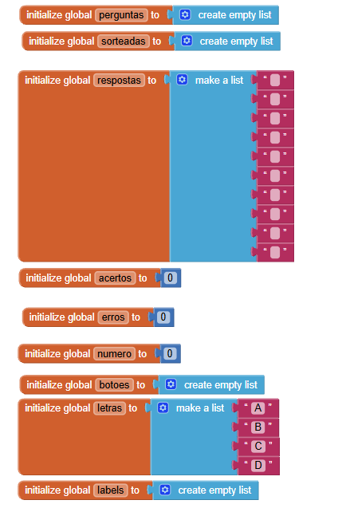

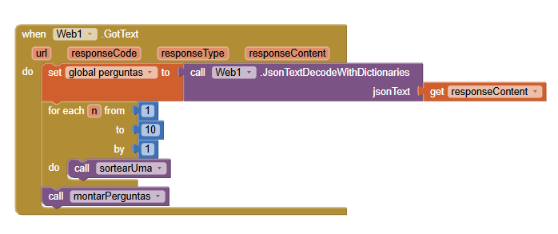

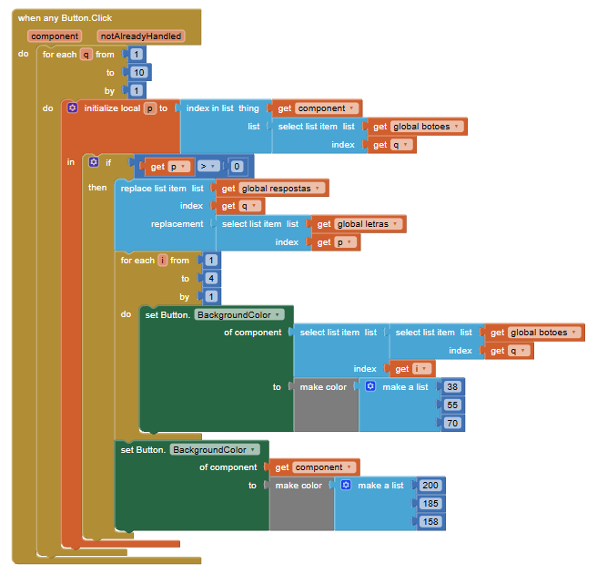

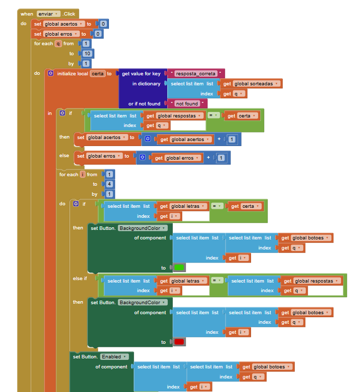

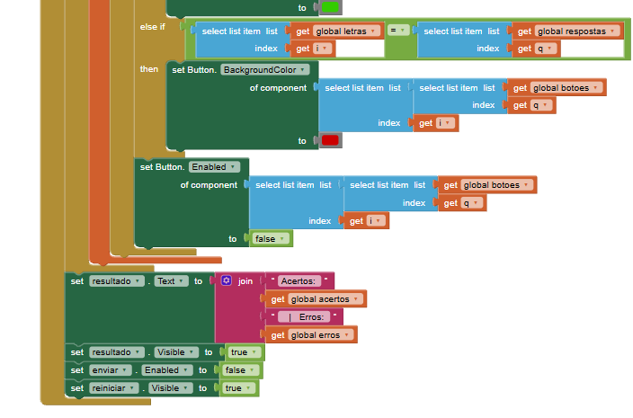

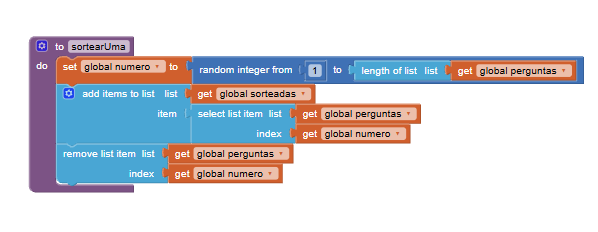

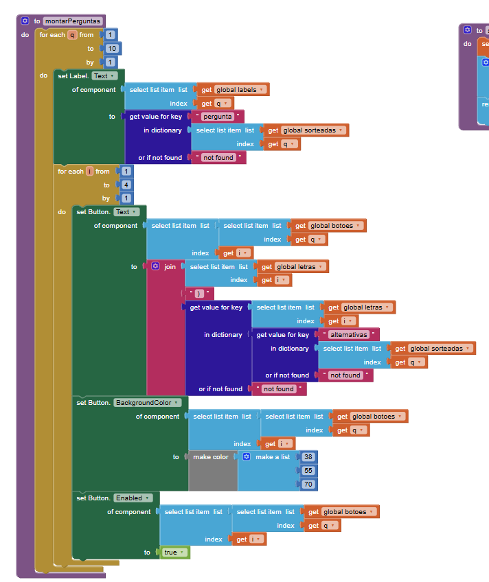

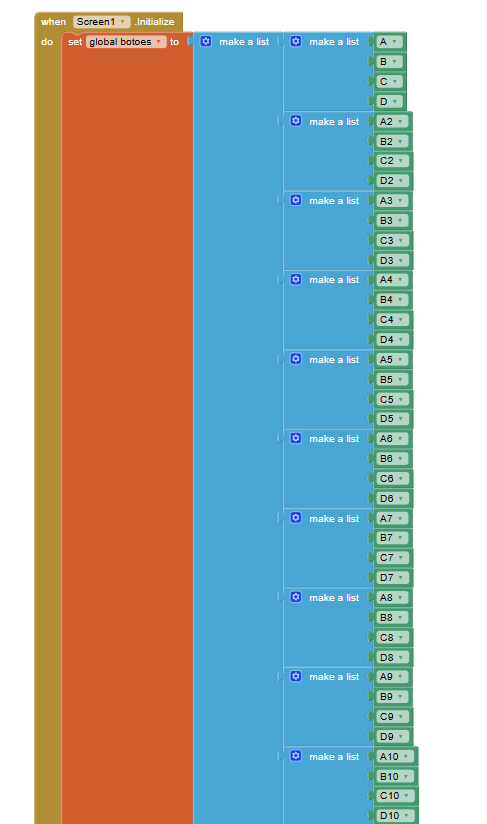

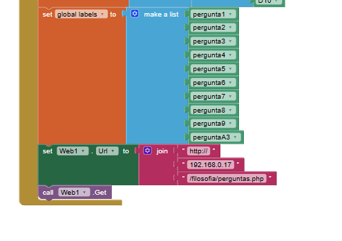

---

## DECLARAÇÃO DE USO DE INTELIGÊNCIA ARTIFICIAL

| Ferramenta | Etapa | Finalidade | Validação |
|---|---|---|---|
| Claude | Desenvolvimento | Auxílio no entendimento do código relacionado à agenda e de sua lógica de funcionamento. | As explicações foram analisadas e utilizadas como apoio à compreensão do código. |
| ChatGPT | Desenvolvimento visual | Auxílio na criação de imagens utilizadas no aplicativo. | As imagens geradas foram analisadas e selecionadas de acordo com a proposta visual do aplicativo. |
| ChatGPT | Desenvolvimento | Auxílio na compreensão e elaboração de códigos e procedimentos utilizados no aplicativo. | As sugestões foram revisadas, adaptadas quando necessário e verificadas durante os testes do aplicativo no MIT App Inventor. |

O uso das ferramentas de Inteligência Artificial ocorreu como apoio ao desenvolvimento do projeto. As sugestões e os materiais gerados foram analisados pelos autores, que permanecem responsáveis pelo funcionamento, pelo conteúdo e pelas decisões tomadas durante a construção do aplicativo.

---

*Relatório desenvolvido para fins educacionais no curso de Informática para Internet.*
